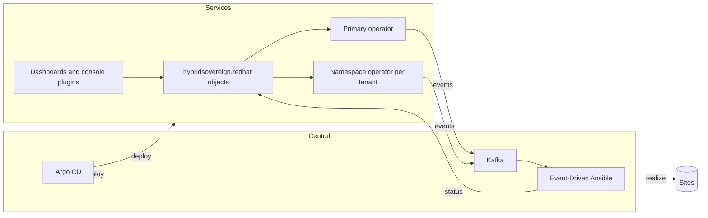

# Hybrid Sovereign Cloud

Hybrid Sovereign Cloud is a multi-tenant cloud control plane on OpenShift. A platform team runs
**sites** (OpenShift Virtualization clusters, OpenStack clouds, AWS and Google Cloud regions) and
a **fabric** that connects them. Each customer organisation is a **tenant**: inside its tenant it
creates **environments** (its slice of a site: a VM environment, an OpenStack project, an AWS
account, a Google Cloud project), private **networks** that span environments and sites, and
OpenShift clusters, Vaults, AAP and Quay organizations, all through one Kubernetes API, a tenant
dashboard and the OpenShift console.

Everything is declared as objects in the API group `hybridsovereign.redhat/v1alpha1` on the
services cluster. Small Ansible operators publish each change as an event; Event-Driven Ansible
on the central cluster does the work on the sites and writes the result back to the object's
status. Argo CD on the central cluster deploys the whole platform from this repository.

## For tenants

- [Getting started](docs/tenant/getting-started.md): sign in, find your tenant, create a network
  and a VM environment, attach them, reach your VM.
- [Hybrid networks tutorial](architecture/docs/tutorial/09-hybrid-networks.md): networks across
  sites, placements, internet egress.
- [Glossary](docs/tenant/glossary.md), [Access and delegation](docs/tenant/access-and-delegation.md)
  and [Status reasons](docs/tenant/status-reasons.md): the words, who may do what, and what a state
  or reason means.
- [Samples](samples/README.md): one example per kind of object.
- `oc explain <kind>` describes every object and field, for example `oc explain cloudvirt.spec`.

## For the platform team

- [Onboard a tenant](docs/platform/onboard-a-tenant.md): sites, the tenant, access groups,
  roles, sign-in.
- [Bootstrap](bootstrap/README.md): build the charts and seed Argo CD on a new installation.
- [Disconnected deploy](docs/disconnected-deploy.md): what a disconnected installation needs.
- [Architecture](architecture/README.md) and its [index](architecture/docs/architecture.md).
- [Documentation index](docs/README.md).

## For contributors

- [Architecture](architecture/README.md): C4 model, decisions, component references.
- [Feature specs](specs/README.md): the original specifications; the CRDs and `oc explain` are
  authoritative where they differ.
- [Content rules](docs/content/style.md) and the terms they use
  ([terms.yaml](docs/content/terms.yaml)); run `make check-content` before a change to CRD
  descriptions, docs, samples or UI strings.
- `make check-manifests` checks the samples and the YAML in the docs against a cluster
  (server-side dry run).

## The API

All kinds are namespaced. Tenant objects live in the tenant namespace `entity-<tenant>`; platform
objects live in `sovereign-cloud` (integration settings in `sovereign-cloud-plugins`).

| Area | Display term (kind) |
|---|---|
| Tenancy and access | tenant (`Entity`), tenant profile (`TenantProfile`, read-only, written by the platform), access group (`Rbac`) |
| Environments | OpenShift Virtualization environment (`CloudVirt`), OpenStack environment (`CloudOSO`), AWS environment (`CloudAWS`), Google Cloud environment (`CloudGCP`) |
| Networks | network (`HybridNetwork`), network placement (`NetworkPlacement`), edge connection (`AttachmentCircuit`) |
| Clusters | OpenShift cluster (`PlatformOpenshift`), team setup (`Team`), app project (`Project`), cluster assignment (`Assignment`) |
| Platform services | Vault (`Vault`), KV secrets engine (`VaultKV`), AAP organization (`AAPOrg`), Quay organization (`QuayOrg`) |
| Sites and fabric (platform) | site (`CloudInfrastructure`), site gateway (`CloudGateway`), fabric (`HybridFabric`), provider edge (`ProviderEdge`) |
| Integrations (platform) | identity provider connection (`RbacConfig`), automation connection (`AAPConfig`), registry connection (`QuayConfig`), tenant DNS settings (`DNSConfig`) |
| Diagnostics (platform) | endpoint health check (`UIHealthChecker`) |
| Experimental | VM migration to OpenStack (`OpenStackMigration`) |
| Kept for compatibility, no effect | `Persona` (deprecated), `TransportLink` and `Iaac` (not implemented) |

The schemas are in [operator/config/crd/bases/](operator/config/crd/bases/); the chart installs
them from `operator/primary/helm/templates/crds.yaml`, kept in lockstep with
`scripts/crd-descriptions.py lockstep`.

## How it is built

| Cluster | Runs |
|---|---|
| Central (management) | Argo CD (the only GitOps control plane, for both clusters), RHACM, Vault, Gitea, Keycloak, AMQ Streams (Kafka), AAP controller with Event-Driven Ansible |
| Services (tenants) | the primary operator and one namespace operator per tenant, the tenant and admin dashboards, the console plugins, Keycloak for tenant sign-in, Vault, the AAP controller |



| Layer | Technology |
|---|---|
| Platform | OpenShift 4, OpenShift GitOps (Argo CD), RHACM |
| Operators | Ansible Operator SDK |
| Automation | Ansible Automation Platform, Event-Driven Ansible, decision environments |
| Messaging | AMQ Streams (Kafka), SASL_SSL |
| Secrets and identity | HashiCorp Vault, External Secrets Operator, Red Hat build of Keycloak |
| UI | PatternFly 6, TypeScript; React 18 (dashboards), React 17 (console plugins) |
| Packaging | Helm 3 charts in an OCI registry |

## Repository layout

```
bootstrap/     Argo CD app-of-apps chart, platform charts, bootstrap automation
operator/      primary/ and namespace/ operators, the CRDs (config/crd/bases)
eda/           rulebooks and roles that realize every kind
aap-config/    AAP and EDA configuration as code
charts/        charts the platform installs on sites and clusters
ui/            dashboards, console plugins and their shared library
iaac/          Git export of the platform's objects
migration/     VM migration playbooks
samples/       one example per kind
docs/          guides and the content rules
specs/         original feature specifications
architecture/  C4 model, decisions, technical references
tests/         test specifications
```

## Rules this repository keeps

- No secrets in Git: credentials come from Vault through External Secrets.
- After bootstrap every change goes through Argo CD: build, bump the chart or image version, set
  it in `bootstrap/helm/central/values.yaml`, sync.
- `sovereign-*` namespaces are never deleted.
- CRDs describe intent and stay the same across installations; how an installation realizes them
  lives in the Ansible role defaults.

## License

See [LICENSE](LICENSE).
