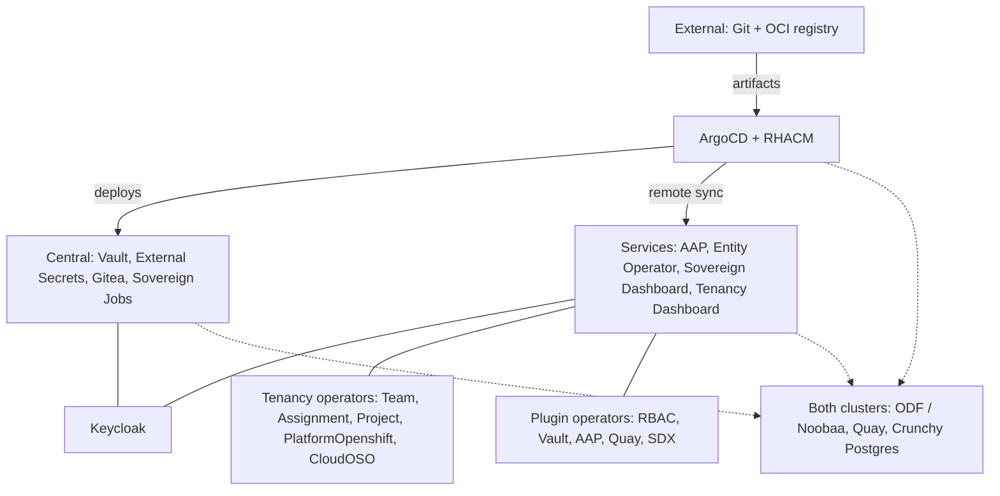
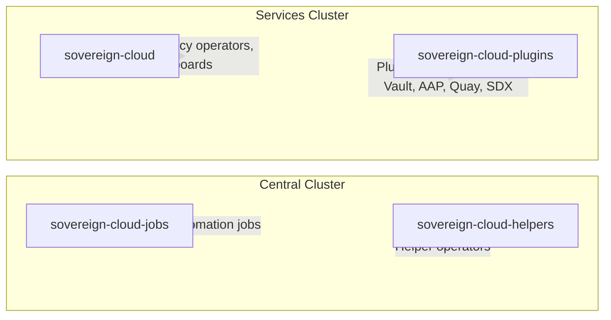
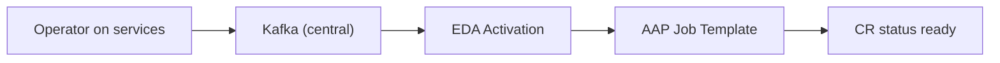

# Platform Components

## Component Map

The diagram keeps each **cluster role** as explicit nodes (≤15). Use the tables below for the full deployed list.

## Namespace Topology

## What Each Component Does

| Component | Description | Where |
|---|---|---|
| **ArgoCD** | GitOps engine — keeps clusters matching Git | Central |
| **RHACM** | Multi-cluster management and visibility | Central |
| **Keycloak (RHBK)** | Identity and access management (SSO) | Central & Services |
| **Vault** | Secrets management, encryption-as-a-service | Central |
| **External Secrets (ESO)** | Syncs secrets from Vault to Kubernetes | Central |
| **Gitea** | Self-hosted Git service | Central |
| **Sovereign Jobs** | Ansible automation for platform config | Central |
| **ACS (RHACS)** | Security scanning and compliance | **Disabled** |
| **AAP** | Ansible Automation Platform | Services |
| **ODF / Noobaa** | S3-compatible object storage for Quay | Both |
| **Quay** | Enterprise container image registry | Both |
| **Crunchy Postgres** | Production PostgreSQL operator | Both |
| **Entity Operator** | Tenant namespace provisioning from `Entity` CRs | Services |
| **Persona** (deprecated) | `Persona` CR — role bindings per access group; deprecated, roles are set in `Entity.spec.namespaceRbac` | Services |
| **Team Operator** | `Team` CR lifecycle and status from namespace context | Services |
| **Assignment Operator** | `Assignment` CR — links teams, projects, platforms | Services |
| **Project Operator** | `Project` CR lifecycle and status | Services |
| **PlatformOpenshift Operator** | `PlatformOpenshift` CR — surfaces platform cluster metadata | Services |
| **CloudOSO** | `CloudOSO` CR — an OpenStack project on an OpenStack site, created by EDA with the site's credential; status includes **project** + **domain** | Services |
| **Sovereign Dashboard** | Entity workflows + **cluster-wide Overview** (CR health) + **Services** (Routes + live probes) | Services |
| **Tenancy Dashboard** | Tenancy + plugin CR UI (teams, assignments, Vault, AAP, Quay, RBAC) | Services |
| **Plugin RBAC** | Keycloak RBAC from `RbacConfig` / `Rbac` | Services |
| **Plugin Vault** | Per-entity Vault instances and KV from `Vault` / `VaultKV` | Services |
| **Plugin AAP** | AAP orgs and OIDC from `AAPConfig` / `AAPOrg` | Services |
| **Plugin Quay** | Quay orgs and OIDC from `QuayConfig` / `QuayOrg` | Services |
| **IAAC git-sync** | Python StatefulSet `iaac-git-sync` exporting `hybridsovereign.redhat` CRs to Gitea `tenancy_repo` (replaces the retired Plugin SDX) | Services |

## Persona (deprecated)

> Deprecated: roles are given to access groups in `Entity.spec.namespaceRbac`; see [Onboard a tenant](../../../docs/platform/onboard-a-tenant.md). This section describes the earlier design.

The Persona operator decouples RBAC role assignment from the Entity operator. Previously, `Entity.spec.namespaceRbac` listed Rbac CR names per role type; Persona CRs now declare each binding independently.

| Field | Purpose |
|-------|---------|
| `spec.type` | One of the role types (e.g., `entityAdmin`, `teamAdmin`, `assignmentAdmin`) |
| `spec.rbac` | Reference to an `Rbac` CR in the same entity namespace |

Reconciliation follows the EDA event pattern: the operator emits `PersonaCreateRequested`, EDA/AAP configures Keycloak groups and Kubernetes RoleBindings, then patches `status.ready`. See [Persona overview](008-persona-overview.md) and [Persona operator](../archive/technical/45-persona-operator.md).

## Git export (`iaac-git-sync`)

The `iaac/` Python StatefulSet `iaac-git-sync` in `sovereign-cloud-plugins` exports the tenancy CRs to Gitea
`tenancy_repo` on the central cluster. It replaced the Go Plugin SDX controller, which is retired
([retired components](../architecture.md#retired-components); archived reference:
[25-plugin-iaac.md](../archive/technical/25-plugin-iaac.md)).

## EDA / AAP Architecture

Heavy automation runs outside operator pods via Event-Driven Ansible and AAP Controller job templates:

1. Operator validates the CR and publishes a typed event (`<Kind>CreateRequested`, ...) to Kafka on central
2. The EDA activation consumes it from Kafka and matches event reason + kind
3. The activation calls `run_job_template`
4. AAP runs Ansible in an Execution Environment container
5. Role patches CR status with `ready` and `edaJobs` (AAP job URL)

**Coverage:** every `hybridsovereign.redhat` kind. The Git export (`iaac-git-sync`) syncs to Gitea separately. See [EDA overview](006-eda-overview.md) and [AAP job templates](../technical/48-aap-job-templates.md).

## Dashboard Stack

Two React/Node.js dashboards deploy to `sovereign-cloud` on the services cluster, both protected by `ose-oauth-proxy` and the logged-in user's OAuth token.

| Dashboard | Repo | Primary users | Key pages |
|-----------|------|---------------|-----------|
| **Admin dashboard** | `ui/packages/admin-dashboard` | Platform admins | Overview (CR health), Services (route probes), Entity list/create |
| **Tenant dashboard** | `ui/packages/tenant-dashboard` | Tenant admins | Teams, Assignments, Projects, PlatformOpenshift, CloudOSO, Persona, plugin CRs |

Shared patterns: PatternFly 6 (one shared page library), Retry now (the `reconcileNow` annotation), EDA job link chips, entity namespace sidebar (`hybridsovereign.redhat/entity` label). See [Sovereign Dashboard](../technical/15-sovereign-dashboard.md) and [Tenancy Dashboard](../technical/20-tenancy-dashboard.md).

## Operator Placement Rules

| API Group | Cluster | Examples |
|---|---|---|
| `hybridsovereign.redhat` | **Services** | Primary operator (platform kinds, `sovereign-cloud`) and one namespace operator per tenant namespace (tenant kinds) |
| `helper.hybridsovereign.redhat` | **Central** | *(future additions)* |

## How Components Relate

1. **ArgoCD** reads from Git and deploys workloads to central and services (remote **Application** targets).
2. **RHACM** registers and monitors the services cluster from central.
3. **Keycloak** provides SSO for operators and dashboard users on both clusters.
4. **Vault** stores platform secrets; **External Secrets** materializes them into namespaces (including plugin admin credentials).
5. **External OCI / Quay** stores Helm charts and images consumed by ArgoCD and cluster pulls.
6. **ODF/Noobaa** backs object storage for **Quay**; **Crunchy Postgres** supports data services (Keycloak, AAP, Quay, and others).
7. **Sovereign Jobs** (central) post-configures Keycloak, Vault, and Gitea after GitOps rollout.
8. **Entity Operator** provisions entity namespaces from `Entity` CRs; tenancy operators enrich **Team**, **Project**, **Assignment**, and **PlatformOpenshift** status from namespace labels and cross-CR references (**Assignment**). **CloudOSO** additionally reports the OpenStack **project** and **domain** identifiers ([Tenancy operators, archived](../archive/technical/24-tenancy-operators.md)).
9. **Sovereign Dashboard** focuses on entity workflows and adds **Overview** (cluster-wide CR health) and **Services** (Routes + health checks); **Tenancy Dashboard** covers tenancy CRs and Vault/AAP/Quay plugin resources with the user’s OAuth token.
10. **Persona** (deprecated) bound a role type to an `Rbac` CR; roles are now set in `Entity.spec.namespaceRbac`.
11. **Plugin kinds** (RBAC, Vault, AAP, Quay) are reconciled by the operators like every other kind, against the shared `*Config` CRs in **sovereign-cloud-plugins**. The Git export (`iaac-git-sync`) watches all tenancy CRs and exports stripped YAML to Gitea; it does not use the EDA event path.
12. **EDA/AAP** on the central cluster executes all provisioning/teardown Ansible via job templates; operators on services emit events only.
