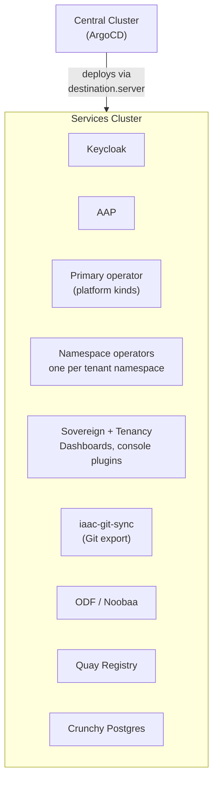

# Services Cluster

## What runs here

The services cluster runs the actual platform workloads and all `hybridsovereign.redhat` operators. It doesn't manage itself — the central cluster manages it via ArgoCD and RHACM.

## Namespaces

| Namespace | Purpose |
|---|---|
| `sovereign-cloud` | Primary operator, Sovereign Dashboard, Tenancy Dashboard, console plugins |
| `sovereign-cloud-plugins` | `iaac-git-sync` (Git export); the `*Config` connection CRs |
| `entity-<tenant>` | The tenant's namespace operator and objects |

These namespaces are **not** deployed on the central cluster anymore. They were removed there so they exist only on the services cluster.

## How it gets managed

1. ArgoCD on central cluster creates Applications with `destination.server` pointing to the services cluster URL
2. The services cluster is registered with ArgoCD via a cluster secret (created by `helm/init`)
3. ArgoCD deploys and syncs workloads remotely
4. There is NO ArgoCD ApplicationSet or Application on the services cluster

## Components Deployed Here

| Component | Namespace | Purpose |
|-----------|-----------|---------|
| Keycloak (RHBK) | `rhbk` | Tenant identity and access management |
| AAP | `aap` | Ansible Automation Platform |
| Primary operator | `sovereign-cloud` | Platform kinds (Entity, sites, fabric, connections); deploys the namespace operators |
| Namespace operator | `entity-<tenant>` | Tenant kinds (Team, Assignment, Project, PlatformOpenshift, environments, networks, plugin kinds) |
| Sovereign Dashboard | `sovereign-cloud` | Entity management UI with OpenShift OAuth |
| Tenancy Dashboard | `sovereign-cloud` | Tenancy + plugin CR UI; user OAuth token to Kubernetes API |
| IAAC git-sync | `sovereign-cloud-plugins` | CR-to-Gitea export of the `hybridsovereign.redhat` CRs (replaces the retired Plugin SDX) |
| ODF / Noobaa | `openshift-storage` | Object storage for Quay |
| Quay | `quay-enterprise` | Container image registry |
| Crunchy Postgres | `openshift-operators` | PostgreSQL operator |

## Operator Placement Rules

| API Group | Must Deploy Here | Examples |
|---|---|---|
| `hybridsovereign.redhat` | **Yes** | Primary operator; namespace operators |
| `helper.hybridsovereign.redhat` | **No** (central only) | *(future)* |

## Connection to Central

| How | Detail |
|---|---|
| Registered via | ArgoCD cluster secret (created by `helm/init`) |
| Managed by | RHACM MultiClusterHub on central |
| Synced by | Central ArgoCD Applications with `destination.server` |

## NON-NEGOTIABLE Restrictions

1. **NO** ApplicationSet on the services cluster
2. **NO** Application on the services cluster
3. **NO** RHACM on the services cluster
4. All management goes through central ArgoCD
